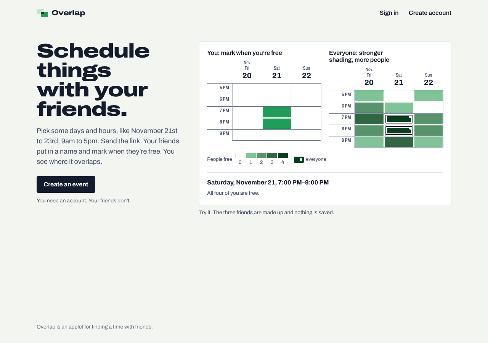
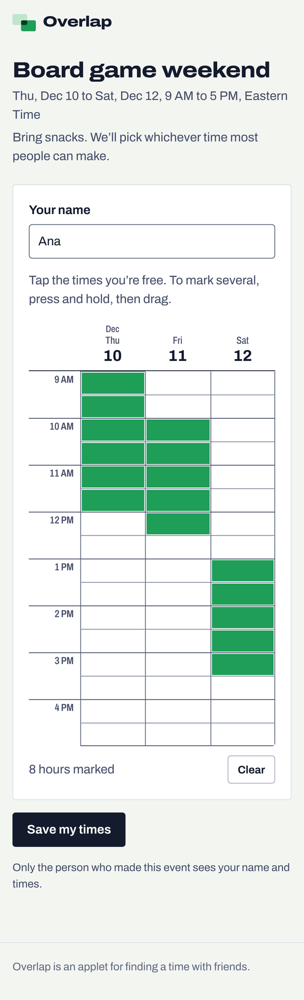
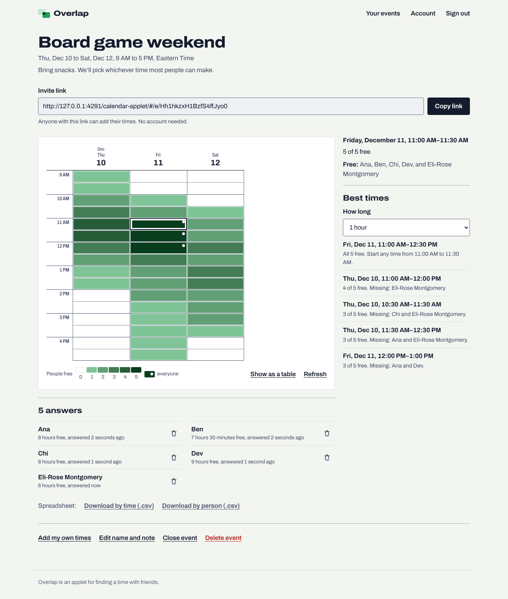

# Overlap

Find a time everyone is free. An organizer picks some days and a daily time window, sends one
link, and each invitee types their name and marks when they can make it. No account or password
for invitees. The organizer sees a shaded grid of who is free when, a ranked list of the best
times, and can download everything as CSV.

It is a static website for GitHub Pages. Accounts and data live in a free Firebase project that
you own.

| Home | Invite page | Organizer's view |
| --- | --- | --- |
|  |  |  |

## Put it online

You do three things once: create a Firebase project, paste four values into one file, and turn
on GitHub Pages. Until the second step is done the site shows these same instructions to
visitors instead of a broken page.

### 1. Create the Firebase project (about ten minutes, free, no card)

1. Go to <https://console.firebase.google.com/> and choose **Add project**. Google Analytics can
   stay off. The free **Spark** plan is all this needs.
2. **Build > Authentication > Sign-in method**: enable **Email/Password** (for organizers) and
   **Anonymous** (so invitees can save their times without an account).
3. **Authentication > Settings > Authorized domains**: add `YOUR-NAME.github.io` (your own
   name, not plain `github.io`, which would authorize every GitHub Pages site there is). This
   lets the confirmation email send people back to your site.
4. **Build > Firestore Database > Create database**. Pick a location near you and choose
   **production mode**. Never use test mode: it lets anyone read and overwrite everything.
5. **Firestore Database > Rules**: replace what is there with the contents of
   [`firestore.rules`](firestore.rules) and choose **Publish**. These rules are what keep each
   organizer's answers private; the site does not work safely without them.
6. **Project settings (gear icon) > General > Your apps**: add a **Web app** and copy the
   configuration it shows.

### 2. Connect the site

Open [`js/config.js`](js/config.js) and fill in the four values from step 6:

```js
firebase: {
  apiKey: '…',
  authDomain: '…',
  projectId: '…',
  appId: '…',
},
```

Commit the change. These values identify your project; they are not passwords and are meant to
be public. What protects the data is the rules from step 5.

### 3. Turn on GitHub Pages

In the repository on GitHub: **Settings > Pages > Build and deployment > Source: GitHub
Actions**. That is the only setting. From then on, every push to `main` runs the tests and, if
they pass, publishes the site to `https://YOUR-NAME.github.io/calendar-applet/` (the first run
takes several minutes; watch it under the **Actions** tab).

GitHub Pages on the free plan needs the repository to be public.

Publishing this way has two advantages over serving the branch directly: a change that breaks a
test never goes live, and each release puts the scripts in a freshly named folder, so a
returning visitor never runs a mix of old and new files.

<details>
<summary>Prefer the simpler "Deploy from a branch"?</summary>

It works too: choose **Deploy from a branch**, branch **main**, folder **/ (root)**. Then
delete the `publish` job from `.github/workflows/site.yml`, or it will fail on every push.
You lose the two advantages above, and visitors may see a half-updated site for up to ten
minutes after each change.

</details>

### Check it on your real project

The tests in this repository run against Firebase's local emulators, which are close to the
real service but not identical. After setting up, spend five minutes confirming these on the
live site:

1. Create an account. The confirmation email arrives (look in spam), and after opening its link
   the site lets you create an event.
2. Create an event and open its invite link in a private window. Save an answer without signing
   in; it appears on your results page after **Refresh**.
3. In the private window, change the answer and save again.
4. Back on the results page: download both CSV files, **Close responses**, and check the private
   window can no longer save.
5. Delete the event. Its invite link now says the event cannot be found.

If step 1's email never arrives, check *Authentication > Templates* in the Firebase console and
that step 3 of the setup (authorized domain) was done.

### Recommended once it works

- **Restrict the API key.** In the [Google Cloud console](https://console.cloud.google.com/apis/credentials),
  open the key named "Browser key", and under *Website restrictions* allow only
  `https://YOUR-NAME.github.io/*` and `https://YOUR-PROJECT.firebaseapp.com/*`. Under *API
  restrictions* allow only Identity Toolkit API, Token Service API and Cloud Firestore API.
  This stops other sites from using your project's quota.
- **Set a password policy.** *Authentication > Settings > Password policy*: require at least 15
  characters and leave the character-type requirements off, to match what the sign-up form asks
  for. (Fifteen is the current NIST minimum when a password is the only thing protecting an
  account. Length matters; forced symbols do not.)
- **Keep email enumeration protection on** (*Authentication > Settings > User actions*; it is on
  by default for new projects).
- **Name the sender.** *Authentication > Templates* controls the sender name of the
  confirmation and password-reset emails. They come from a `firebaseapp.com` address, so some
  land in spam; the site tells new organizers to look there.
- **Add a second owner** to the Firebase project (*Project settings > Users and permissions*),
  or at least sign in to the console once a year. Google may delete a personal Google account
  that goes unused for two years, and the project with it.
- **App Check** (optional) makes it much harder for a script to burn through your free daily
  quota. Enabling it means adding the App Check SDK to `scripts/firebase-entry.js` and the
  reCAPTCHA hosts to the Content-Security-Policy in `index.html`; it is not wired up here. If
  the site is ever abused, this is the lever to reach for.

## What people can do

**Organizers** create an account (email and password) and confirm their email by opening the
link Firebase sends them. Until they do, the database itself refuses to let the account create
events. Then they can:

- create an event: a name, up to 31 days picked on a calendar, a daily window such as 9:00 AM to
  5:00 PM (windows that run past midnight work too), slots of 15, 30 or 60 minutes, and a time
  zone;
- copy or share the invite link;
- watch answers arrive on a grid shaded by how many people are free, pick any time to see who
  is and is not free, show one person alone, or read it all as a table;
- see the best times for a meeting of a chosen length, ranked by how many people can make the
  whole of it;
- download a CSV with a row per time slot and a column per person, or one listing each person's
  free stretches;
- close the event to new answers, reopen it, remove an answer, or delete the event.

**Invitees** open the link, type a name, and mark their times: drag with a mouse, tap or
press-and-hold-then-drag on a touch screen, or use the arrow keys and Space. They can come back
from the same browser to change or remove their answer. People in other time zones see the
times converted to theirs and can switch to the event's zone.

## Things worth knowing

- **Days and hours are fixed once an event is created.** Answers are stored as one mark per
  slot, so changing the slots afterwards would scramble them. Create a new event instead.
- **Invitees are recognised by their browser, not their name.** That is what stops one person
  overwriting another's answer by typing the same name. The other side of it: someone who
  clears their browser data, switches device, or opens the link inside another app's built-in
  browser cannot edit their old answer. They can answer again and you can remove the old one.
  Signing in or out of an organizer account on the same browser does not affect it.
- **Nothing expires by itself.** Events, answers and guest identities stay until you delete
  them. Deleting an event removes its answers and retires its link for good; deleting your
  account removes all your events. Removing old events once in a while is good manners towards
  the people whose names are in them.
- **The invite link is the key to the event.** Anyone who has it can read the event's name and
  note and add an answer. Only you can read the answers. The part of the link after `#` is
  never sent to GitHub or to any other site.
- **Free-plan limits.** Firestore's free plan allows 50,000 reads and 20,000 writes a day,
  which is far more than a group of friends needs. If the quota is ever used up the site stops
  working until the next day (midnight Pacific time); it cannot run up a bill. Firebase also
  allows about 100 new sign-ups an hour from one network address, guests included, so a
  lecture hall answering all at once from one Wi-Fi network may be asked to wait a few minutes.
  A results page shows at most 500 answers.
- **Browsers.** Current Chrome, Edge, Firefox and Safari, on computers and phones. Anything from
  roughly 2023 onwards works; older browsers get a message asking for an update.
- **Every site under one `github.io` name shares browser storage.** If you publish other Pages
  sites from the same GitHub account that run code you do not trust, give this one its own
  domain.
- **If you rename the repository**, change the three `/calendar-applet/` paths in
  [`404.html`](404.html) to match.
- **To rename the app**, change `appName` in [`js/config.js`](js/config.js) and the `<title>` in
  [`index.html`](index.html).

## How it is built

No build step: the browser loads the files in this repository as they are.

```
index.html            the one page; holds the Content-Security-Policy
css/app.css           all styles, light and dark
js/main.js            start-up and the router (#/, #/new, #/e/<id>, #/e/<id>/results …)
js/config.js          your Firebase settings
js/backend.js         every call to Firebase (sign-in, events, answers)
js/core/              plain logic with no browser or Firebase dependency: time zones, slots,
                      availability sums, CSV, validation
js/ui/                the timetable grid, the calendar, small DOM helpers
js/views/             one file per page
js/vendor/firebase.js the Firebase SDK, bundled from npm (see below)
firestore.rules       who may read and write what
scripts/              assembling the published folder, and bundling the SDK
tests/                unit, security-rule and browser tests
.github/workflows/    runs the tests and publishes the site
```

### Security, in short

- Passwords are handled entirely by Firebase Authentication; this site never stores or sees a
  password hash. New passwords must be at least 15 characters. Sign-in and password-reset
  messages never reveal whether an email has an account. (Sign-up cannot hide it: Firebase
  itself refuses a second account for the same address.) Changing a password or deleting an
  account asks for the current password again.
- An account can create events only after its email address is confirmed, and that is checked
  by the database rules, not just by the page.
- All access control is in [`firestore.rules`](firestore.rules), enforced by Firestore itself,
  and covered by tests in `tests/rules/`. Every field of every write is checked there.
- Deleting an event leaves a marker under its id, so nobody can later create an event with the
  same id and take over an old invite link.
- One person can save an answer at most every five seconds (the page waits by itself), which
  limits how fast a single visitor can use up the daily quota.
- The page runs only its own scripts (`script-src 'self'`), loads nothing from third parties,
  may talk only to the Firebase sign-in and database hosts, never submits a form to a server,
  and enforces Trusted Types so no string can be turned into markup. The Firebase SDK is served
  from this repository rather than a CDN.
- Everything people type is put on the page as text, never as HTML. Names in CSV files are
  neutralised so a spreadsheet cannot run them as formulas.
- The page refuses to run inside another site's frame.

### Time zones

An event is defined in its organizer's time zone, and the instant each day's window opens is
stored with the event when it is created. Browsers do not always agree on a zone's rules
(several regions changed theirs in 2026), so every visitor reads those stored instants rather
than redoing the sum. The grid always has one column per event day; only the labels change
with the viewer's zone, and a column whose clock times differ from the row labels (because of
a daylight-saving change) says so.

## Working on it

Needs Node 24 and Java 21 or newer (the Firestore emulator is a Java program).

```sh
npm install
npx playwright install chromium firefox webkit   # once: the browsers the tests drive
npm run test:unit     # logic: time zones, slots, CSV, validation, and checks on the site's files
npm run test:rules    # security rules, against the Firestore emulator
npm run test:e2e      # the real site in Chromium, Firefox and WebKit, against the emulators
npm test              # all three
```

The browser tests include automated accessibility checks (axe-core) of every page in the light
and dark colour schemes, and touch-screen tests on phone profiles.

To click around locally without a Firebase project, start the emulators and the test server in
two terminals, then open <http://127.0.0.1:4173/calendar-applet/>:

```sh
npx firebase emulators:start --only auth,firestore --project demo-calendar-applet
npm run serve
```

`npm run serve` serves the repository as GitHub Pages would, except that it swaps in a
configuration pointing at the emulators.

### Updating the Firebase SDK

`js/vendor/firebase.js` contains only the functions listed in `scripts/firebase-entry.js`,
bundled from the `firebase` npm package at the version pinned in `package.json`:

```sh
npm install --save-dev --save-exact firebase@latest
npm run vendor
npm test
```

## Credits

- Typeface: [Archivo](https://github.com/Omnibus-Type/Archivo) by Omnibus-Type, SIL Open Font
  License 1.1 (`assets/fonts/OFL.txt`).
- [Firebase JavaScript SDK](https://github.com/firebase/firebase-js-sdk), Apache License 2.0.
- The approach was informed by reading how when2meet, crab.fit, Timeful and Rallly work. No
  code was taken from them.
